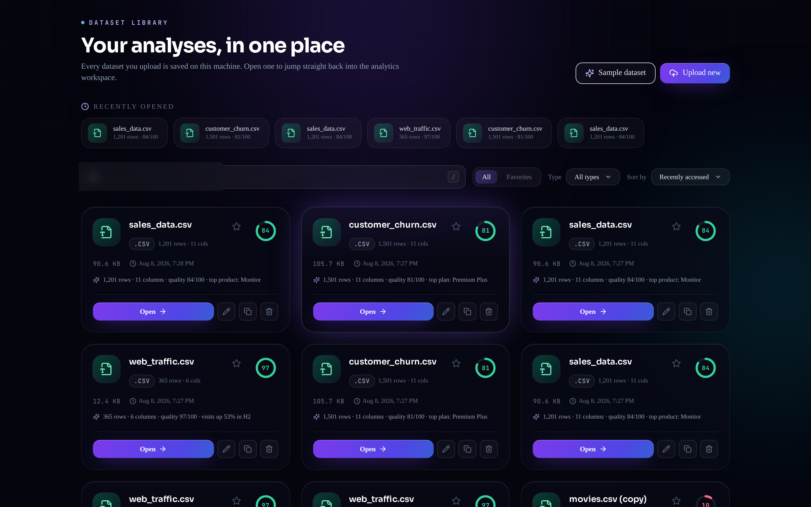

# AutoData


AutoData is a local-first workspace for analyzing spreadsheets. Upload a CSV, TSV, or Excel workbook, inspect its rows, preview cleaning operations, and build charts and reports from the cleaned data. The built-in analyst answers supported questions without an API key.

[Quick start](#quick-start) · [First analysis](#try-it-with-sample-data) · [Local development](#local-development) · [Deployment](#deploy-to-render)

## Quick start

With Git and Docker Compose installed, run:

```sh
git clone https://github.com/JayanGupta/AutoData.git
cd AutoData
docker compose up --build
```

Open the app and select **Try the sample dataset** to explore retail sales. You can also upload your own `.csv`, `.tsv`, `.xlsx`, or `.xls` file. The default upload limit is 50 MB. [Open AutoData on localhost](http://localhost:3000)

## Try it with sample data

1. **Inspect the rows.** In **Overview**, filter the sales table to one region. The filter changes the table view. Expand a column profile to see its inferred type, missing values, and statistics.
2. **Review a cleaning step.** Open **Clean data → Remove duplicates**, choose **Selected columns**, and select `order_id`. The preview identifies which rows will be kept and removed. Apply the change or adjust the matching columns. **Undo last step** restores the previous data.
3. **Build a chart.** In **Visualizations**, choose **Bar**, set X to `region`, Y to `revenue`, and **Summarize by** to **Sum**. Select **Create chart** to compare regional revenue. For individual order values, choose **None (show individual rows)**. That view displays up to 400 valid rows after filtering.
4. **Build a dashboard.** Select **Add to dashboard** on the chart. Dashboard Studio combines saved charts and KPI cards, supports filtering, and offers a print preview with the dataset name and active filters.
5. **Prepare a report.** Open **Report**, select the sections you want, arrange them, and select **Generate preview**. Export the outline in your chosen order as HTML, Markdown, or PDF. To download the cleaned rows themselves, use **Export** and choose CSV or XLSX.

## Workspace features

| Area | What you can do |
| --- | --- |
| Dataset library | Search, favorite, rename, or duplicate datasets. Explore the bundled retail sales, customer churn, and web traffic samples. |
| Cleaning Studio | Check missing values, duplicates, and outliers. Fill blanks, trim text, change types, or remove duplicates using one or more matching columns. |
| Visualizations | Start with up to two suggestions or choose the axes, aggregation, scale, and filter yourself. Available views include bar, line, area, histogram, scatter, donut, and summary table. Load advanced analyses on demand. |
| AI Analyst and Insights | Ask questions in plain English and inspect computed patterns such as trends, correlations, and outliers. |
| Connect and merge | Import public Google Sheets or combine datasets by joining on shared keys or appending rows. |

<details>
<summary>View the dataset library</summary>



</details>

## Local development

Use Python 3.11 and Node.js 22 to match the project's CI environment. Start the FastAPI backend and Next.js frontend in separate terminals, both beginning in the repository root.

**Backend on macOS or Linux**

```sh
cd backend
python3 -m venv .venv
. .venv/bin/activate
python -m pip install -r requirements.txt
python -m uvicorn app.main:app --reload
```

**Backend on Windows PowerShell**

```powershell
cd backend
py -3.11 -m venv .venv
.\.venv\Scripts\python.exe -m pip install -r requirements.txt
.\.venv\Scripts\python.exe -m uvicorn app.main:app --reload
```

**Frontend on either platform**

```sh
cd frontend
npm ci
npm run dev
```

The frontend serves the workspace on port 3000 and proxies requests under `/api` to FastAPI on port 8000. The backend uses pandas for analysis and SQLite for dataset sessions and cleaning history. [Workspace](http://localhost:3000) · [API documentation](http://localhost:8000/docs)

## Storage and privacy

Local analysis runs on the machine hosting the backend. A native install stores SQLite data in `backend/app/data` by default. Docker Compose uses the `dataset-store` volume. Sessions expire after two hours of inactivity by default. Export cleaned data or reports you want to retain.

For optional external language-model support, configure `USER_LLM_API_KEY`, `USER_LLM_BASE_URL`, and `USER_LLM_MODEL`. For native development, copy the backend example to `backend/.env`. For Compose, set these variables in the shell or a repository-root `.env` file. When enabled, the configured provider can receive questions, column names, statistics, and limited query results. AutoData excludes columns it detects as sensitive from external analyst queries and generated reports. [Backend environment example](backend/.env.example) · [Compose environment example](.env.example)

## Deploy to Render

Create a Render Blueprint from this repository. It defines a Next.js frontend and a FastAPI backend with browser-scoped workspaces. Use the frontend's HTTPS URL so its proxy and workspace cookie work together. Clearing that cookie removes the browser's access to its previous workspace.

The configured free backend uses ephemeral storage. For durable SQLite storage, attach a persistent disk on a supported plan and set `AUTODATA_DATA_DIR` to its mount path. Session expiration still applies. [Render Blueprint](render.yaml)

## Tests and contributions

- **Backend:** From `backend/`, run `python -m unittest discover -s tests` with the project virtual environment active. On Windows, you can use `.\.venv\Scripts\python.exe` directly.
- **Frontend:** From `frontend/`, run `npm run lint` and `npm run build`. The production build includes TypeScript checks.

Bug reports, feature ideas, and pull requests are welcome, including AI-assisted contributions. AutoData is distributed under the MIT license. [Contributing guide](CONTRIBUTING.md) · [Code of conduct](CODE_OF_CONDUCT.md) · [License](LICENSE)
